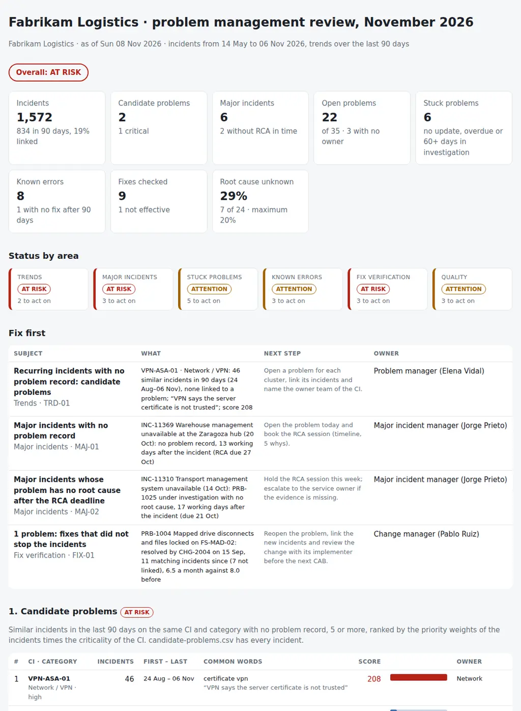

# Problem Management Review

The monthly problem review: which recurring incidents should become problems, which open problems are stuck, where the root cause is still unknown, which known errors have a workaround but no permanent fix, which fixes did not stop the incidents, and what goes to the next problem review and the next CAB. From the incidents and problems exported from the ITSM tool (Jira Service Management, HaloITSM or EasyVista), the changes linked to the problems and the CIs of the CMDB, it puts together:

- **Trends:** clusters of similar incidents on the same CI and category with no problem record, the *candidate problems*, ranked by how many there are, their priority and the criticality of the CI.
- **Major incidents:** major incidents with no problem record, or with a problem and no root cause, after five working days.
- **Stuck problems:** no update for a month, past the target date, under investigation for more than 60 days, no owner, or owned by a team other than the one that owns the CI.
- **Known errors:** a workaround documented and no change for the permanent fix after 90 days, workarounds the service desk has not got, known errors with no workaround.
- **Fix verification:** problems fixed by a change while matching incidents keep arriving, problems closed on a change that was backed out, reopened incidents.
- **Quality:** root cause recorded as *Unknown* or *Other*, problems closed without a root cause or a change, duplicate problems on the same CI.

Four CSVs, one JSON with the thresholds and one Python command give every area a status (**HEALTHY**, **ATTENTION** or **AT RISK**) and the pack for the monthly problem review, with the agenda, a decision column and the list for the CAB: **what becomes a problem, what is stuck and why, and what needs a change.**

Python 3.10+, standard library only. It runs with fictional demo data out of the box. A read-only PowerShell exporter for the Jira Service Management Cloud REST API is included; HaloITSM and EasyVista exports with the same columns work too.

Major incidents are run and reviewed with [36-major-incident-command-kit](https://github.com/inigogonzalezgarcia/36-major-incident-command-kit), and the permanent fixes reach the CAB through the change calendar of [40-change-calendar-risk-review](https://github.com/inigogonzalezgarcia/40-change-calendar-risk-review); this review is the loop between them, from the incident that keeps coming back to the change that should stop it.



## Why

Problem management is the part of ITSM that everyone agrees with and nobody has time for. In a typical month:

- forty-six incidents about a VPN certificate error have been resolved one by one with the same workaround since late August, and nobody has opened a problem;
- seventeen printer driver incidents at one site look like seventeen different tickets in the queue;
- the warehouse system went down for four hours three weeks ago and there is still no problem record; the transport system outage of the week before has one, under investigation, with no root cause;
- a known error on the warehouse scanners has had a workaround for 120 days and nobody has raised the change for the fix;
- a change closed the file share problem in September, and eleven more incidents of the same kind have arrived since, most of them not linked to it;
- three open problems have no owner, two are duplicates of each other, and one has not been updated for two months;
- and almost a third of the root causes are *Unknown* or *Other*.

Each of these is visible in the ITSM tool, one ticket at a time. The review reads the incidents, problems and changes together, groups the incidents by CI, category and the words of their summaries, applies the same rules every month, and gives the problem review one list. The rules are in `settings.json` and `problemreview/checks.py`.

## What it checks

| Area | Code | Finding |
|---|---|---|
| Trends | TRD-01 | `cluster_min` or more similar incidents in `window_days` on the same CI (or service) and category, none or few linked to a problem: a candidate problem, critical with a score of `cluster_critical_score` or more or with a major incident in it |
| Trends | TRD-02 | Incidents that match an existing problem and are not linked to it (information) |
| Major incidents | MAJ-01 | Major incident with no problem record: critical after `rca_working_days` working days, a warning before |
| Major incidents | MAJ-02 | Major incident whose problem has no root cause after `rca_working_days` working days (critical) |
| Stuck problems | STK-01 | Open problem with no update for `stale_days` |
| Stuck problems | STK-02 | Open problem past its target date |
| Stuck problems | STK-03 | New or under investigation for more than `investigation_max_days` |
| Stuck problems | STK-04 | Open problem with no owner (critical when it comes from a major incident) |
| Stuck problems | STK-05 | Owner team different from the owner team of the CI in the CMDB |
| Stuck problems | STK-06 | Review date passed (information) |
| Known errors | KER-01 | Workaround for `known_error_fix_days` and no implemented change for the permanent fix (critical after `known_error_critical_days`; information when a change is planned) |
| Known errors | KER-02 | Workaround not published to the service desk |
| Known errors | KER-03 | Known error with no workaround documented |
| Fix verification | FIX-01 | `fix_recurrence_min` or more matching incidents after the change that fixed the problem (critical when the problem is resolved or closed) |
| Fix verification | FIX-02 | Problem resolved or closed on a change that failed or was backed out |
| Fix verification | FIX-03 | Incidents reopened `reopen_min` or more times |
| Quality | QLT-01 | Root cause category unknown or other above `unknown_rc_max` of the problems past investigation (critical above twice) |
| Quality | QLT-02 | Problem resolved or closed with no root cause |
| Quality | QLT-03 | Two open problems on the same CI with similar summaries |
| Quality | QLT-04 | Problem resolved or closed with no linked change (information) |

Similar means sharing at least two words and half the words of the shorter summary, after removing stop words; the score of a candidate is the sum of the priority weights of its incidents times the criticality weight of the CI. An area is AT RISK with a critical finding, ATTENTION with warnings only, HEALTHY otherwise; the overall status is the worst area. [docs/data-format.md](docs/data-format.md) has every rule.

## Outputs

| File | What |
|---|---|
| `report.html` | Overall status, tiles (incidents, candidate problems, major incidents, open and stuck problems, known errors, fixes checked, root cause unknown), status by area, "Fix first", candidate problems with their score, major incidents and RCA, open problems, known errors, fix effectiveness, quality, the list for the CAB and all findings |
| `problem-review-pack.md` | The pack for the monthly problem review: decisions with a proposal and a decision column, status by area, headlines, a 60-minute agenda, scope and evidence, candidate problems, major incidents, open problems, known errors, fix effectiveness, quality, the list for the next CAB, findings, actions, notes and sign-off |
| `candidate-problems.csv` | Every candidate with its CI, service, category, criticality, incidents, dates, priorities, score, common words, proposed owner, every incident key, and columns for the decision and the problem opened |
| `problem-status.csv` | Every problem with status, owner and teams, age, last update, target and review dates, root cause category, workaround, changes, linked incidents, major incidents, findings and next step |
| `known-errors.csv` | Every open problem with a workaround or in *Known error*: since when, the workaround, published or not, the change and its status, incidents, findings and a decision column |
| `fix-effectiveness.csv` | Every problem fixed by a change: the change, implementation date and outcome, matching incidents before and after, rates and verdict, and the incidents after |
| `actions.csv`, `findings.csv` | The findings with owner, items and due date, and columns for the decision |

## Try it

```bash
git clone https://github.com/inigogonzalezgarcia/46-problem-management-review.git
cd 46-problem-management-review
python -m problemreview demo
```

Open `output/report.html` and `output/problem-review-pack.md`.

### The demo data

The demo is a made-up logistics company, Fabrikam Logistics, with about 1,800 people at Madrid HQ, the Zaragoza hub and the Valencia port warehouse, reviewed on Sunday 8 November 2026 for the problem review of Thursday 12 November and the CAB of Tuesday 17 November:

- 1,572 incidents from 14 May to 6 November, as Jira Service Management would export them, across 23 CIs (laptops, Exchange Online, Entra ID, Teams Phone, the warehouse and transport management systems, the ERP, handheld scanners, Wi-Fi, printers, the file server, the VPN, EDI, labels and backup);
- 35 problems in every status, 20 changes (12 linked to problems) and the CMDB with criticality and owner team.

Everything is fictional: people, tickets and CIs. The problems are placed on purpose among the everyday ones:

- **Trends:** 46 incidents about a VPN certificate error since 24 August with no problem (score 208, critical); 17 printer driver incidents on the Zaragoza print server (score 23).
- **Major incidents:** the warehouse management outage of 20 October with no problem record after 13 working days; the transport management outage of 14 October with its problem still under investigation and no root cause; a Teams Phone outage of 5 November with its RCA due on the 12th.
- **Stuck problems:** three problems with no owner, a problem under investigation for 130 days and not updated since September, four past their target date, one owned by the service desk instead of the team that owns the laptops.
- **Known errors:** the Zebra scanners losing Wi-Fi between aisles, with a workaround for 120 days and no change; a workaround the service desk has not got; a known error with no workaround.
- **Fix verification:** the file share problem resolved by a change on 15 September, with 11 matching incidents since, 7 of them not linked; a problem closed on a change that was backed out; four incidents reopened twice.
- **Quality:** root cause *Unknown* or *Other* on 7 of 24 problems past investigation (29%), two problems closed with no root cause, two open problems that are the same problem.

The result: **AT RISK**, 2 candidate problems, 2 of 6 major incidents without RCA in time, 6 of 22 open problems stuck, 1 of 9 fixes not effective, 4 critical findings and 15 warnings, and four items for the CAB.

## Use it with your own data

1. Export (read-only) from Jira Service Management Cloud:
   ```powershell
   .\scripts\Export-ProblemReviewData.ps1 -Site https://contoso.atlassian.net -Project ITSM -ListFields
   .\scripts\Export-ProblemReviewData.ps1 -Site https://contoso.atlassian.net -Project ITSM -OutputFolder .\data `
       -ServiceField customfield_10044 -CIField customfield_10210 -TeamField customfield_10001 -MajorIncidentField customfield_10070 `
       -RootCauseCategoryField customfield_10301 -WorkaroundField customfield_10303 -PublishedField customfield_10304 -ReopenCount
   ```
   It sends only GET requests to `/rest/api/3/search/jql` (JQL, fields and pagination with `nextPageToken`) and `/rest/api/3/field`, with your Atlassian email and an API token asked for with `Get-Credential` and never written to disk. The custom field ids are the ones of your site (`-ListFields` prints them). From HaloITSM or EasyVista, export the incident and problem lists with the same columns; the column names in [docs/data-format.md](docs/data-format.md) and their alternatives are accepted.
2. Add `cmdb.csv` (CI, service, criticality, owner team) from Assets or your CMDB, and adjust `data/settings.json`: the window, the similarity and cluster thresholds, priority and criticality weights, working days and holidays, the dates of the next review and CAB, and the owners.
3. Build the outputs:
   ```bash
   python -m problemreview review data/
   ```

[docs/problem-review.md](docs/problem-review.md) has who attends, the monthly cadence, how to read the pack, when to open a problem, RCA techniques (timeline, 5 whys, Ishikawa), how a problem becomes a change through the CAB, and how to record decisions.

The exports contain names, CIs and the history of your incidents. Keep them inside your organisation:

- real files at the top level (`incidents*.csv`, `problems*.csv`, `changes*.csv`, `cmdb*.csv`, `settings.json`, `data/`, `downloads/`) and the `output/` folder are excluded from Git by `.gitignore`;
- only the fictional files in `sample_data/` are committed.

## Tests

```bash
pip install -r requirements-dev.txt
python -m pytest -q
```

GitHub Actions runs them on Python 3.10 and 3.12 on every push, then rebuilds the fictional sample data and the report screenshot from the simulator.

14 tests: loading Jira Service Management columns (priorities, dates with time zone, linked problems, statuses, workaround as text); word similarity and clustering; candidate problems ranked with priority and criticality, and the window; clusters that match an existing problem; major incidents without a problem or a root cause and working days with holidays; stuck, overdue, unowned and misassigned problems; known errors; fixes not effective, failed changes, reopened incidents and the CAB list; quality; area status and overall; settings overrides; the pack and the CSVs; missing files; and the demo end to end (deterministic, all eight outputs).

## Next steps

- Run the export every Monday and the review before each monthly problem review.
- Keep last month's `candidate-problems.csv` and show which clusters became problems and which keep growing.
- Read the CIs and their criticality straight from Assets instead of a CSV.
- Add HaloITSM and EasyVista exporters through their APIs.
- Show the trend of the share of incidents linked to a problem, month by month.

## Background

Built from my work running IT service management processes:

- formal process owner of incident and request, change (CAB) and problem management, CMDB and configuration management, process dashboards and audit responses;
- leading the technical response in major incidents, and the post-mortems and root cause analysis after them;
- tracking the backlog, quality and ageing of tickets and support escalations, working with offshore teams, and defining and tracking SLAs and OLAs;
- Jira and Jira Service Management and Confluence as administrator, EasyVista, HaloITSM and HaloPSA, and GLPI; PowerShell automation and Python;
- writing runbooks and procedures, and training others in the incident, change and release processes.

Written from scratch with fictional data; no employer data, systems or exports are used.

## Customisation and contact

Want this adapted to your environment? For example:

- your ITSM tool and its fields (Jira Service Management custom fields, HaloITSM, EasyVista, GLPI);
- your categories, priorities, root cause categories and thresholds;
- your CMDB as the source of criticality and owner teams;
- the pack in the format of your problem review and CAB.

Get in touch:

- Website (contact form): [inigogonzalezgarcia.github.io](https://inigogonzalezgarcia.github.io/about.html#contacto)
- LinkedIn: [linkedin.com/in/igonzalez93](https://www.linkedin.com/in/igonzalez93)

## License

MIT
